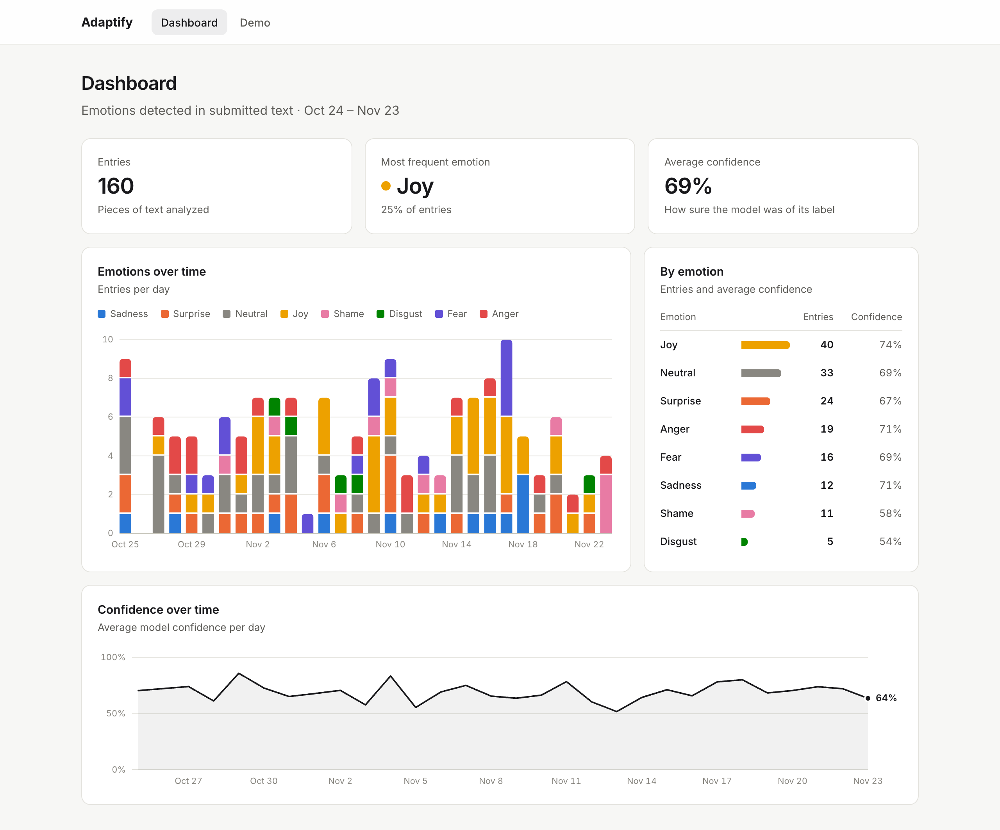
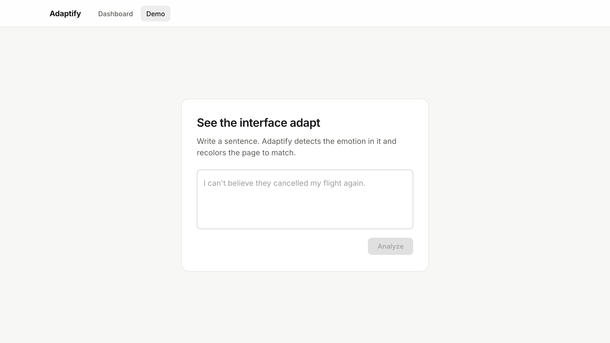
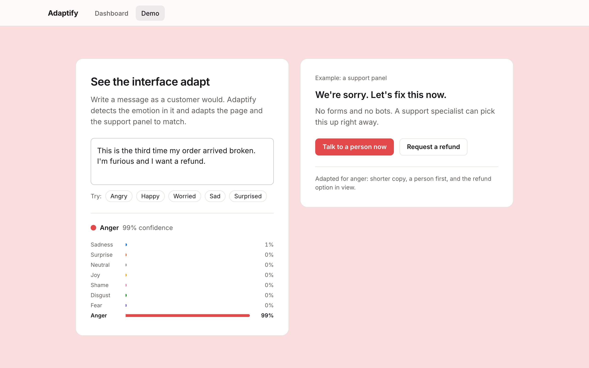

# Adaptify
Adaptive user interface based on human emotion. 

Adaptify is designed to adjust its visual elements in response to the emotional cues detected from user-provided text. By analyzing input data, it dynamically modifies the interface to reflect a range of emotional states, offering both insights and a personalized user experience. 

Use the Dashboard and Demo links in the header to switch between the two.

## Demo
Try it out [here.](https://adaptify-frontend.vercel.app/dashboard)

The demo runs on free hosting, so the first load can take up to a minute while the server wakes up. Its data is sample data that resets whenever the server restarts.

## Features
* **Live emotion detection** - The demo analyzes text as you type and shows the probability of each of eight emotions: anger, disgust, fear, joy, neutral, sadness, shame and surprise.
* **Adaptive interface** - The page takes on the color of the detected emotion, and an example support panel changes its wording and actions to suit it. An angry message, for example, brings "Talk to a person now" and a refund option to the front.
* **"Not sure" state** - When the model's confidence is below 45%, the interface stays neutral instead of guessing.
* **Dashboard** - Entries per day by emotion, a ranked breakdown with average confidence per emotion, and average confidence over time.
* **API** - A single endpoint that classifies text and lists recorded entries. It stores data in SQLite by default, or in Supabase when configured.

## Frontend
Frontend repo found [here.](https://github.com/cocomittens/adaptify-frontend)

## Running locally
Requires Python 3.9–3.11 (the pinned numpy/scikit-learn versions don't support newer Pythons).

```bash
git clone https://github.com/cocomittens/adaptify
cd adaptify
python3.9 -m venv .venv
source .venv/bin/activate
pip install -r requirements.txt
cp .env.example .env            # optional; sets DEBUG=True
python manage.py migrate
python manage.py seed_demo      # optional; sample history for the dashboard
python manage.py runserver
```

The API is now at `http://localhost:8000/api/text/`:

```bash
# Detect the emotion in a piece of text
curl -X POST http://localhost:8000/api/text/ \
  -H 'Content-Type: application/json' \
  -d '{"text": "I am so happy today"}'

# Analyze without recording an entry
curl -X POST http://localhost:8000/api/text/ \
  -H 'Content-Type: application/json' \
  -d '{"text": "I am so happy today", "save": false}'

# List all recorded emotions
curl http://localhost:8000/api/text/
```

The response contains the top `emotion`, its `confidence`, and the `probabilities` of all eight emotions.

No configuration is needed: by default everything is stored in a local SQLite file.
To use Postgres instead, set `DATABASE_URL` in `.env`; to use Supabase, fill in the Supabase values (see `.env.example`).

## Screenshots
### Dashboard

The dashboard displays historical trends and various metrics of users' emotions.

### Demo
### Neutral

The demo before any emotion is detected: a neutral page and the default support panel.

### Angry

After an angry message: the page takes the emotion's color and the support panel puts a person and a refund first.

## Planned Features
* Sign in and per-user data - The demo currently records everything under one demo user.
* Persistent storage for the hosted demo.
* More adaptive components - The support panel is one example; the goal is a reusable set of components driven by emotion.
* Dashboard filters - Date ranges and per-user views.
